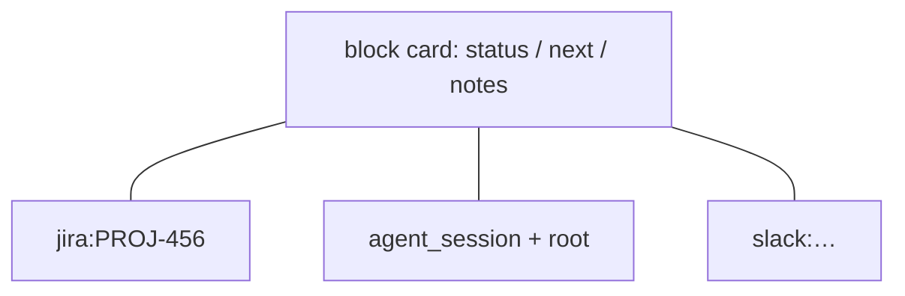

<!-- cf73e8a7-d4fe-44dc-9fd8-c75b528cd2ab -->
---
todos:
  - id: slate-repo
    content: "Create BasitAli/slate: README, CHANGELOG, ROADMAP, docs/plans/ (move this plan in)"
    status: completed
  - id: slate-cli
    content: "Phase 1 in repo: slate CLI — block hub, start/open/review/capture/…"
    status: completed
  - id: slate-skill
    content: "Phase 1 in repo: Claude skill — implement + review (PR→Jira extract)"
    status: completed
  - id: slate-ui
    content: "Phase 2 in repo: noctalia-slate plugin — cards + /slate launcher"
    status: completed
  - id: nixos-wire
    content: "nixos-config: package/skill/plugin source + usage/CHANGELOG inventory"
    status: completed
  - id: slate-wisp
    content: "Phase 3: Wisp macros sample in slate repo docs"
    status: completed
isProject: false
---
# Slate — linked work graph + Noctalia UI + Wisp

## Where it lives

**Everything for slate** (code **and** planning) lives in **[`BasitAli/slate`](https://github.com/BasitAli/slate)** (`basitali/slate`). **`noctalia-slate` is a plugin inside that repo**, not under nixos-config’s `noctalia-plugins/`.

```
BasitAli/slate/
  README.md             # what it is, install/wire, quick start
  CHANGELOG.md          # human-readable releases / notable changes
  ROADMAP.md            # phased goals (Phase 1 CLI → 2 noctalia-slate → 3 Wisp → later)
  docs/
    plans/              # all design plans / journey specs (canonical; move Cursor plans here)
    journeys.md         # A–F user journeys (or split files under docs/)
    usage.md            # how to drive slate day-to-day
  cli/ …                # slate CLI
  skill/slate/SKILL.md  # Claude Code skill
  noctalia-slate/       # plugin id basitali/noctalia-slate
  examples/             # ithaka.toml, wisp-slate-commands.toml
```

**Maintain in-repo, continuously:**

| Doc | Role |
|-----|------|
| `README.md` | Entry point: vision, layout, install, link to usage/roadmap |
| `CHANGELOG.md` | What shipped (Added/Changed/Fixed), newest first |
| `ROADMAP.md` | What’s next vs done; points at `docs/plans/` for detail |
| `docs/plans/` | Full plans (this slate plan + future ones) — **not** left only in `.cursor/plans/` |

**[`nixos-config`](https://github.com/BasitAli/nixos-config)** only **wires** consumption (like `noctalia-wisp`):

- Package/`PATH`, Noctalia git plugin source, skill hookup
- Short pointer in usage + inventory + a changelog line when the wire-up changes
- No duplicate slate design plans in nixos-config

Imperative runtime data stays on the machine: `~/.local/share/slate/`, `~/.config/slate/*.toml`.

**Local clone path:** [`/work/Developer/personal/slate`](/work/Developer/personal/slate)  
(same tree as `noctalia-worldclock` and other personal BasitAli projects under `/work/Developer/personal/`).

**Bootstrap:** `gh repo create BasitAli/slate` → clone/create at that path → copy this plan into `docs/plans/slate.md` → seed README, CHANGELOG, ROADMAP → Phase 1.

## Vision

**`slate`** = today's work surface → eventual portal. The UI unit is a **`block` card** (hub node): status, next steps, notes. Children (Jira, agent sessions, Slack, …) hang off it via edges. Profiles **`ithaka`** / **`personal`**. Agents write via skill; you browse cards; voice via Wisp.

## Linking policy

- You (or `slate open`) say “working on PROJ-456” → skill ensures a **block**, links **jira** + **agent_session** to that block (not session↔jira only as the primary structure; session↔jira may still exist as convenience edges, but **block is canonical**)
- Later Slack/PD/PR → `add` + `link` **to the block**
- No kitty-focus auto-link; no `CLAUDE_CODE_SESSION_ID` in v1
- Voice `slate add jira KEY` alone = orphan stub until attached to a block

## Delivery order

| Phase | Ship | Depends on |
|-------|------|------------|
| **1 — Core** | CLI + graph + **block cards** + profiles + skill (+ `open`) | — |
| **2 — UI** | **`noctalia-slate`** — one card per block | Phase 1 |
| **3 — Voice** | Wisp → `slate` | Phase 1 |

**Deferred:** Switchboard ingest, Cursor skill, Multica, Claude uuid refs, `.slate.toml` per-repo override.



---

## User journeys

### A. Claude already open

1. You: “Start working on **PROJ-456** — flaky auth.”
2. Skill:
   - Ensure **block** (reuse open block already linked to `jira:PROJ-456` if any; else create titled from key + summary)
   - `slate start … --root …` → link session → **block**
   - `slate add jira PROJ-456` → link jira → **block**
   - Optional: set block `next` / first note from your intent
3. Mid-flight: “link this Slack thread” → add+link to **same block**; `slate next` / `slate note` on the **block** for status narrative
4. You: “this whole thing is done” → `slate done-block <block|jira:KEY>` → block + open children marked done (cascade)

### B. `slate open jira:PROJ-456`

1. Root from `--root` or profile config
2. Kitty at root + `claude` + seed “Start working on PROJ-456.”
3. Skill same as A (block + session + jira)

### C. Morning review

- noctalia-slate / `slate ls`: **cards = open blocks** (status, next steps, child summary)
- Expand card → jira, sessions, slack, …

### D. Stub only

- `slate add jira KEY` with no block → unlinked until an agent attaches it to a block

### E. Code review (story / PR for someone else)

Goal: a **block card** for “review this,” not a build session — unless you also spin Claude to help review.

1. **Intake** — you get a PR + optional Jira (Slack ping, GH/GL notification, standup).
2. **Park / start** — paste the review URL to Claude or CLI:
   ```fish
   slate review https://gitlab.com/org/repo/-/merge_requests/123
   ```
3. **Skill (preferred path when Claude has the URL):**
   - Fetch/read the PR/MR (title, description, branch) via `gh`/`glab` or page content
   - **Extract Jira key(s)** with a simple pattern (e.g. `[A-Z][A-Z0-9]+-\d+`) from title → description → branch name
   - `slate review <url>` (or equivalent) → block + `code_review` (`refs.url`)
   - For each found key: `slate add jira KEY` + `link` → **same block**
   - If no key found: still create review block; note on block `no jira key in PR`; user can add later
   - Optional: `start` session only if user wants agent-assisted review
4. **CLI-only `slate review <url>`** (no agent): creates block + `code_review` only. Optional `--jira KEY` if you already know it. **No forge API scrape in the fish CLI** (keep CLI dumb; skill does extraction).
5. **Do the review** — `note` / `next` on the **block**.
6. **`slate done-block`** when submitted.

UI: card chip + **Open** → `refs.url`; show linked jira keys on the card.

### F. Clipboard → “Add to slate” (noctalia-slate)

1. You copy a **PR/MR URL** or **Jira URL/key**.
2. **noctalia-slate** watches clipboard (debounce; ignore duplicate of last offer).
3. On allowlisted match → notification: **Add to slate** (body = truncated link/key).
4. On action: PR → `slate review <url>`; Jira → `slate capture jira:…` (block + jira child). No auto-add without click. Optional later action: **Open session**.
5. Dismiss / timeout = no-op. Setting `clipboard_offer = false` to disable.

---

## Phase 1 — Core

### Profiles + config

| Profile | Auto when |
|---------|-----------|
| `ithaka` | `$PWD` under `/work/Developer/Ithaka` |
| `personal` | elsewhere |

`~/.config/slate/{ithaka,personal}.toml`:

```toml
root = "/work/Developer/Ithaka"
```

Data: `~/.local/share/slate/{profile}/{nodes,edges}.jsonl`

**Root resolution:** `--root` → chat path → profile `root` → `$PWD`

### Graph

**`block` (the card)** — hub kind:

- `title`, `status` (`open`|`done`; later richer if needed)
- `next` — short “next step” string (or list later; v1 single string)
- `notes[]` — `{at, text}` (block-level narrative; agents update these)
- `started` / `ended`
- Children linked via undirected `related` edges

**`agent_session`:** `root` (absolute), title, status, notes; linked to block

**Stubs:** `jira`|`slack`|`pagerduty`|`code_review` with `refs`; linked to block

### CLI (implemented in `BasitAli/slate`, on PATH via nixos-config)

| Command | Behavior |
|---------|----------|
| `slate start TITLE... [--root DIR] [--block ID]` | New `agent_session`; link to block (create block if omitted and `--jira` given — prefer skill orchestration) |
| `slate block start TITLE...` / ensure via skill | Create open block card |
| `slate add KIND REF [--title …]` | Stub node |
| `slate link A B` | Edge (skill links children → block) |
| `slate note [id] TEXT` | Note on node (default: current session or explicit block id) |
| `slate next [block] TEXT` | Set block `next` (the card’s next step) |
| `slate status [block] STATUS` | Set block status without cascade |
| `slate done [id]` | Done one node |
| `slate done-block [id\|jira:KEY]` | Block `done` + cascade open neighbors |
| `slate show` / `ls` | Prefer listing **blocks** as cards; show children on `show` |
| `slate open jira:KEY [--root DIR]` | Kitty+claude seed; skill builds block graph |
| `slate review <url> [--jira KEY] [--title …]` | Paste MR/PR URL → block + `code_review` (`refs.url`); optional jira; **no** agent launch |
| `slate capture jira:KEY\|<jira-url>` | Ensure block + jira child (clipboard “Add to slate” for tickets; no claude) |
| `slate profile …` | pin/auto |

### Skill (shipped in `BasitAli/slate`, e.g. `skill/slate/SKILL.md`)

- **Implement:** “working on \<JIRA\>” → ensure block; `start` + link; `add jira` + link; seed `next`/note
- **Review:** user pastes MR/PR URL → read PR → extract Jira id(s) → `slate review <url>` + `add`/`link` jira to block; `start` only if they want agent help
- Further artifacts → link to **block**; `slate next` / `note` on the card
- No Claude session env uuid for linking

---

## Phase 2 — UI (`noctalia-slate` inside `BasitAli/slate`)

- Lives at **`noctalia-slate/`** in the slate repo; plugin id **`basitali/noctalia-slate`**
- Registered from nixos-config like wisp: git source → that repo (plugin path / catalog entry for the subdir)
- Cards = **blocks**: title, status, next, note preview, child chips
- Detail: children, notes, actions: done-block, open, copy ids
- Profile toggle ithaka / personal / both
- **Clipboard offer (journey F):** debounced clipboard watch → notification **Add to slate** → CLI. Opt-out setting.

---

## Phase 3 — Wisp

| Say | Runs |
|-----|------|
| `slate list` | `slate ls` (blocks) |
| `slate open PROJ-456` | `slate open jira:PROJ-456` |
| `slate review` + URL | `slate review <url>` (paste-friendly) |
| `slate next …` | `slate next …` on focused/last block if we define that — else require agent; v1 voice may only `open`/`ls`/`add` |
| `slate done block` / `close PROJ-456` | `slate done-block jira:PROJ-456` |

---

## Docs / validate

- **In `BasitAli/slate`:** keep README, CHANGELOG, ROADMAP, and `docs/plans/` current on every meaningful change
- **nixos-config:** wire-up notes only (no second roadmap)
- Imperative on machine: `~/.local/share/slate/`, `~/.config/slate/*.toml`

Validate: repo docs exist and match Phase 1; implement → block+jira+session; review URL → skill extracts Jira; clipboard Add to slate.
